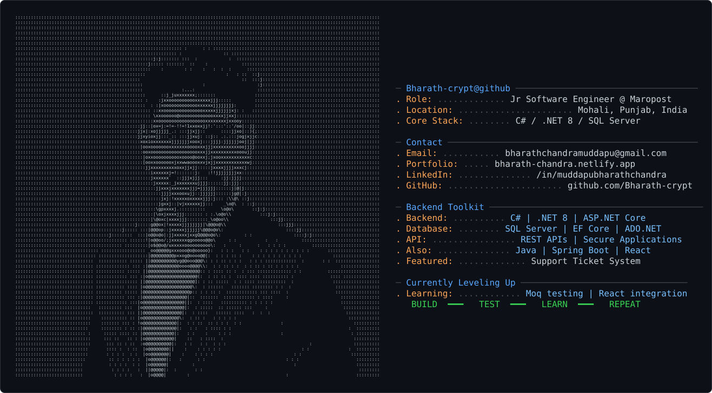

<!-- Profile README for Bharath-crypt/Bharath-crypt -->

# 👋 Hi, I'm Bharath Chandra

### Junior Software Engineer @ Maropost · Backend Developer

Building reliable APIs, learning every day, and turning coffee into code ☕

---

<!-- Keep dark_mode.svg in the repository root beside this README.md. -->

  

---

## 👨‍💻 About Me

I'm a software developer based in Mohali, India, and a B.Tech Computer Science and Engineering graduate from Lovely Professional University. I work at **Maropost as a Junior Software Engineer**, focusing on backend development, REST APIs, databases, and secure applications.

- 💼 **Current role:** Junior Software Engineer at Maropost
- 🔧 **Main stack:** C#, .NET 8, ASP.NET Core Web API, SQL Server
- 🧱 **Data access:** Entity Framework Core and ADO.NET
- ☕ **Fuel:** Black coffee and curiosity
- 🌱 **Currently improving:** API architecture, unit testing with Moq, React, and test automation
- 🎯 **Motto:** Code. Learn. Build. Grow.

## 🧰 Technology Stack

**Backend & Languages**

**Databases & Data Access**

**Tools & Testing**

## 🚀 Featured Projects

### 🎫 [Support Ticket System](https://github.com/Bharath-crypt/SupportTicketSystem)

A .NET 8 Web API for managing support tickets, customers, agents, and ticket comments. Includes ticket creation, agent assignment and reassignment, and SQL Server data access.

**Tech:** C# · ASP.NET Core Web API · SQL Server · ADO.NET · EF Core

### 🤝 [CollabConnect](https://bharath-chandra.netlify.app/#projects)

A team collaboration project with authentication, project discovery and search, and CRUD operations.

**Tech:** Java · Spring Boot · PostgreSQL

### 🛒 [ShopEase — E-Commerce Backend](https://bharath-chandra.netlify.app/#projects)

An e-commerce backend project covering registration, product listing, search, and cart APIs.

**Tech:** Java · Spring Boot · MySQL

### 🎓 [Student Management System](https://bharath-chandra.netlify.app/#projects)

A console application demonstrating CRUD operations, object-oriented programming, arrays, and linked lists.

**Tech:** Java · OOP · Data Structures

[**Explore all projects on my portfolio →**](https://bharath-chandra.netlify.app/#projects)

## 📈 Currently Learning

- Advanced .NET backend development and maintainable API architecture
- SQL Server query writing and database design
- Unit testing, mocking with Moq, and automated testing
- React and frontend-to-backend integration
- Debugging, Git workflows, and clean code practices

## 🏆 Highlights

- **CodeClash DSA:** AIR 53, Unstop (June 2025)
- **Naukri Campus Young Turks:** Top 5% (October 2024)
- **Education:** B.Tech in Computer Science and Engineering, Lovely Professional University

## 🤝 Connect With Me

 

*“I write code, fix bugs, and occasionally create new bugs while fixing old ones.”* 😄

